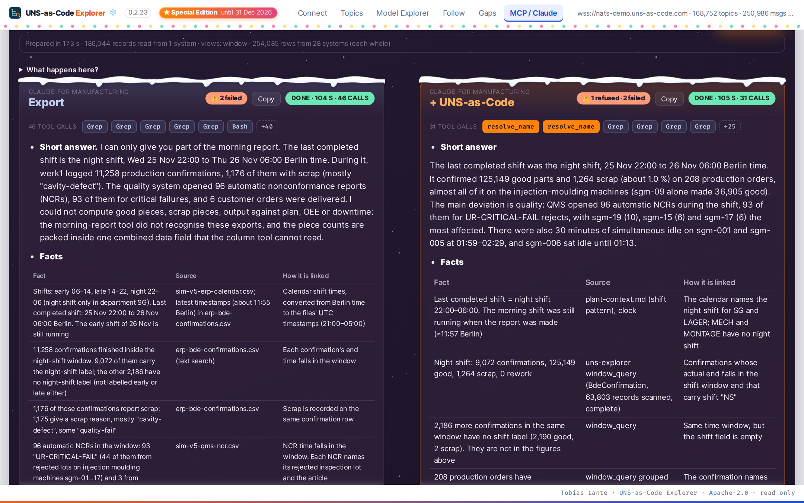
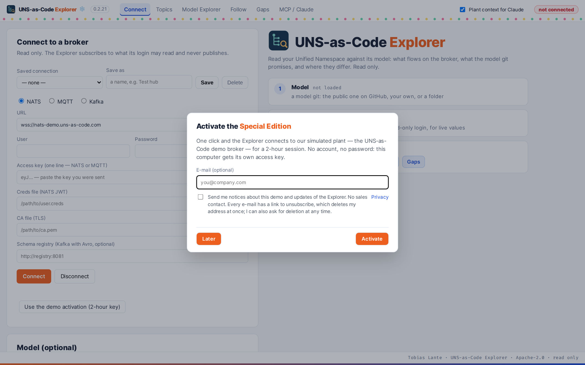
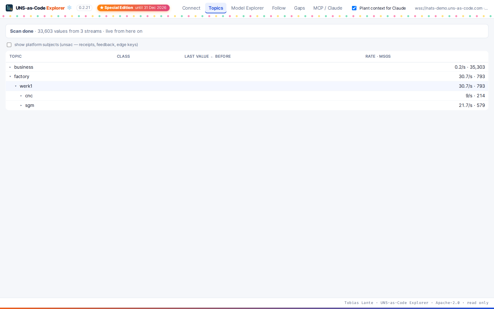
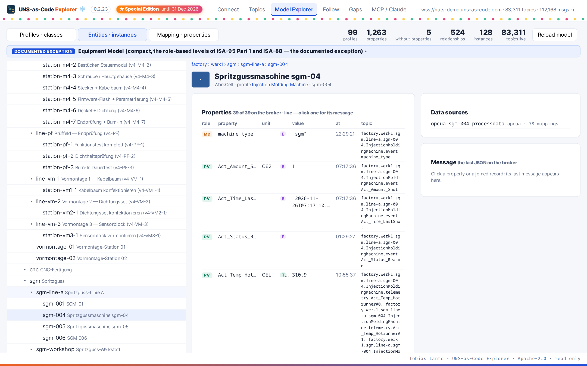
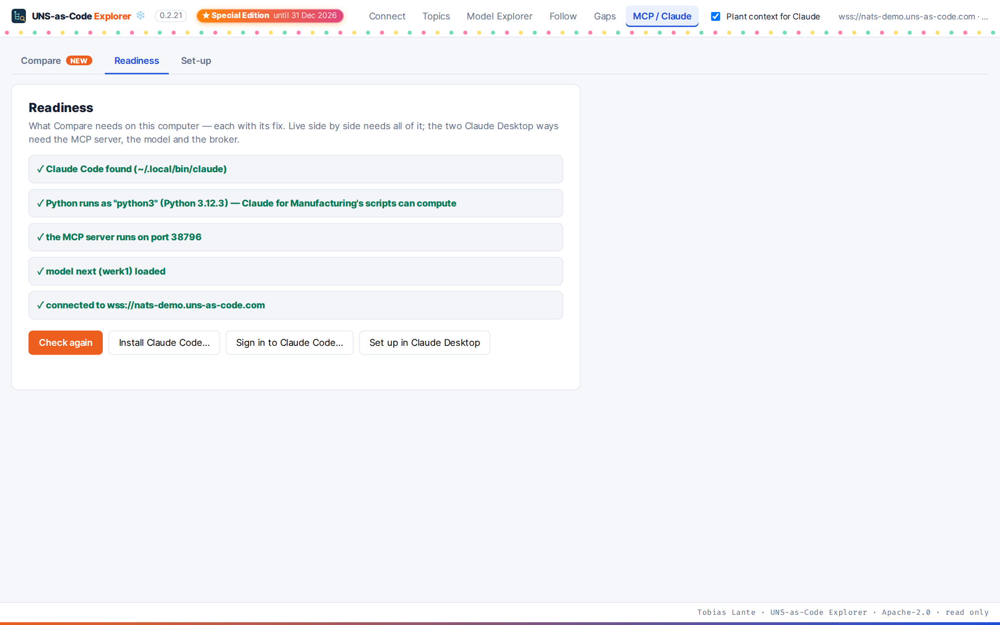
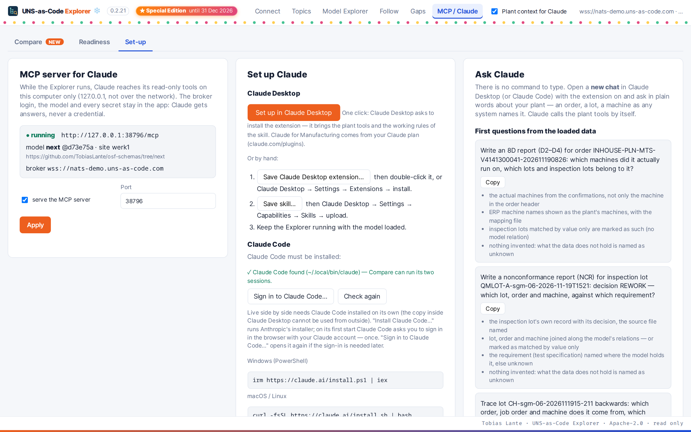
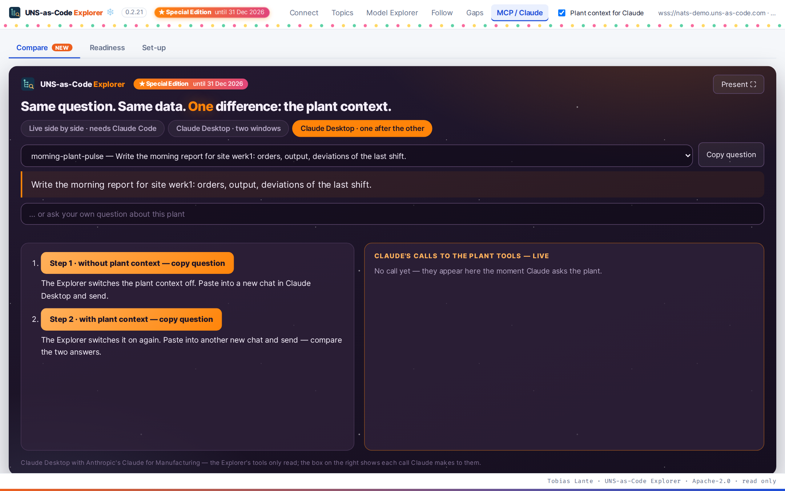

# UNS-as-Code Explorer

**See what your factory's data means — and let Claude answer questions about your plant with the right context.**

The Explorer is a free desktop app (Windows, Linux) that connects to the data hub of a factory — a *Unified Namespace* on NATS,
MQTT or Kafka — and shows every value live, together with what it means: which machine it belongs to, which order, which limit
applies. It only reads; it never changes anything in the plant.

New in 0.2.21: **Compare** — the same question to Claude twice, once on the raw exports of the systems as most plants have them
today, once with the UNS-as-Code plant context. You see side by side what the context changes.

> Beta 0.2.21 — free and open source (Apache-2.0). Feedback welcome in [Issues](../../issues).

---

## Contents

- [In one minute — for managers](#in-one-minute--for-managers)
- [Download](#download)
- [Step by step](#step-by-step)
  1. [Install](#1-install)
  2. [First start: the demo plant](#2-first-start-the-demo-plant)
  3. [See the live data](#3-see-the-live-data)
  4. [Understand the plant](#4-understand-the-plant)
  5. [Ask Claude: Compare](#5-ask-claude-compare)
  6. [Claude Desktop](#6-claude-desktop)
  7. [Your own broker](#7-your-own-broker)
- [What Compare shows, in detail](#what-compare-shows-in-detail)
- [Questions people ask](#questions-people-ask)
- [Words used here](#words-used-here)
- [Licence](#licence)

---

## In one minute — for managers

| | |
|---|---|
| **What it is** | A viewer for the live data of a factory, with the meaning of each value from a model of the plant. |
| **What it shows** | Machines, orders, lots, inspections, limits — and where the systems (ERP, MES, machines) name the same thing differently. |
| **Why Claude** | AI answers about a plant are only as good as the context they get. Compare shows the difference on the same data, live. |
| **Risk** | None to the plant: the Explorer reads only. It never writes to the broker, the machines or the model. |
| **Cost** | The Explorer is free (Apache-2.0). Compare uses *your* Claude account (Claude Code or Claude Desktop). |
| **Try it** | Download, start, one click — the Explorer connects to our simulated plant. No account, no form. |

---

## Download

| System | File |
|---|---|
| Windows 10/11 | [Setup](https://github.com/TobiasLante/uns-as-code-explorer/releases/latest/download/UNS-as-Code-Explorer-win-x64-setup.exe) (no admin rights) · [Zip](https://github.com/TobiasLante/uns-as-code-explorer/releases/latest/download/UNS-as-Code-Explorer-win-x64.zip) |
| Linux x64 | [AppImage](https://github.com/TobiasLante/uns-as-code-explorer/releases/latest/download/UNS-as-Code-Explorer-linux-x86_64.AppImage) · [tar.gz](https://github.com/TobiasLante/uns-as-code-explorer/releases/latest/download/UNS-as-Code-Explorer-linux-x64.tar.gz) (no FUSE, no root) |

The links always give the newest published version. Older versions and checksums: [Releases](../../releases).

> **Note:** 0.2.21 (with Compare and the demo activation) is being published in the next days; until then the links above give 0.2.0.

---

## Step by step

### 1. Install

**Windows:** run the *Setup*. It installs for your user only — no administrator rights needed. The program is not signed yet, so
Windows SmartScreen asks once: click **More info → Run anyway**. Or unpack the *Zip* and start `UNS-as-Code Explorer.exe`.

**Linux:** make the AppImage executable (`chmod +x`) and start it, or unpack the tar.gz and start `uns-as-code-explorer`.

### 2. First start: the demo plant

At the first start the Explorer offers a **2-hour session on our simulated plant** (the UNS-as-Code demo broker): a factory with
injection moulding and CNC machines, an ERP, a quality system and live machine data.

- Click **Activate** — that is all. No account, no password. This computer gets its own access key.
- The e-mail field is **optional**: only if you want notices about the demo and new versions. No sales contact; every e-mail has a
  link to unsubscribe, which deletes the address at once.
- After 2 hours the session ends and the Explorer says so. **Reconnect** starts the next one with one click.
- The demo plant is open until **31 December 2026**. The Explorer itself stays free, and your own broker works without any of this.

### 3. See the live data

**Topics** shows everything the broker carries, as a tree, with the newest value and how often it arrives. Values that belong to the
model are explained: the machine, the attribute, its unit.

Click a line to see its last values, the raw message and what the model says about it.

### 4. Understand the plant

**Model Explorer** shows the plant as the model describes it: site, areas, lines, machines — and for each machine its attributes,
the rules that watch it, its recipes and settings, and which systems deliver its data.

The model comes from a public repository ([osf-schemas, branch next](https://github.com/TobiasLante/osf-schemas/tree/next)); the
Explorer opens it by itself at the first start. **Gaps** shows where the model and the live data disagree; **Follow** follows one
order or lot through the systems.

### 5. Ask Claude: Compare

Open **MCP / Claude**. Three tabs:

| Tab | What it is for |
|---|---|
| **Compare** | The same question to Claude twice — without and with the plant context. |
| **Readiness** | Checks this computer before a run, and offers a fix for whatever is missing. |
| **Set-up** | Connects Claude Desktop to the Explorer, and switches the plant context on or off. |

**First: Readiness.** Each line is green when that part is ready. A red line has its fix next to it; the buttons below install or
sign in to what is missing. While something is missing, the tab shows a red dot.

| Check | Needed for | If it is missing |
|---|---|---|
| Claude Code | the live run side by side | **Install Claude Code…**, then **Sign in to Claude Code…** with your Claude account |
| Python 3 | Claude for Manufacturing's calculations | install Python 3 from [python.org](https://www.python.org/downloads/) (tick *Add to PATH*), then **Check again** |
| MCP server | all ways | runs by itself inside the Explorer |
| Model | all ways | loads by itself (Connect → Model) |
| Broker | all ways | the demo plant (step 2) or your own broker |

**Then: Compare.**

1. Pick a question from the list — six ready questions, taken from the data of the plant you are connected to (see
   [below](#six-ready-questions)) — or type your own.
2. Click **Run both**.
3. Two Claude sessions start at the same moment with the same question. On the **left**, Claude has only the systems' raw exports, as in
   most plants today. On the **right**, Claude has the same exports **plus** the UNS-as-Code plant context.
4. Watch both answer live: the tools each one uses, then six numbers — time, tool calls, plant tools, sources named, ISA-95 relations,
   and what it says it cannot know.
5. **Copy** at the top of each side copies its answer. **Present ⛶** shows the stage full screen, for a meeting or a screen share.

Below the answers, **What to look for** lists what a good answer to this question contains — so the two can be judged line by line,
not by feeling.

### 6. Claude Desktop

No Claude Code? Compare also works in **Claude Desktop**:

1. **MCP / Claude → Set-up → Set up in Claude Desktop** installs the Explorer's extension in Claude Desktop with one click
   (Claude Desktop asks you to confirm *Install*).

   

2. In Compare choose **Claude Desktop · two windows** or **Claude Desktop · one after the other**. The page guides you: copy the
   question, ask it once with the plant context switched off and once switched on. The Explorer shows Claude's calls to its tools
   live while you ask.

   

### 7. Your own broker

**Connect** → enter the address of your broker:

- **NATS** `nats://`, `tls://` or `wss://` — user/password, an access key, a `.creds` file, a CA file
- **MQTT** `mqtt://` or `mqtts://`
- **Kafka** `kafka://` — Avro through a schema registry

Saved connections keep their passwords and keys encrypted in this computer's keychain. With your own model (a folder or a git
repository in the UNS-as-Code format) the Explorer explains your topics the same way.

---

## What Compare shows, in detail

### Both sides use Claude for Manufacturing

Both sessions work with Anthropic's
[Claude for Manufacturing](https://github.com/anthropics/claude-plugins-official/tree/main/plugins/claude-for-manufacturing) plugin
(Apache-2.0, shipped unchanged — see [NOTICE](NOTICE)). The only difference between the two sides is the plant context:

- **Left — raw exports:** the files each system delivers, with each system's own names (the ERP calls a machine `sgm-04`, the machine
  itself `sgm-004`).
- **Right — with the plant context:** the same files, plus the UNS-as-Code skill (the working rules) and the Explorer's tools: one
  identity per machine across all systems, the relations between order, operation, lot and inspection as ISA-95 describes them, the
  limits from recipes and machine settings — each answer with the model file it rests on, and what the model cannot answer named as
  unknown.

### Six ready questions

One question per Claude for Manufacturing skill, built from what the connected plant currently holds:

| Question | Skill | What it tests |
|---|---|---|
| 8D report (D2–D4) for an order | `root-cause-capa` | on which machines the order really ran, which lots and inspections belong to it |
| Nonconformance report for a rejected inspection lot | `ncr-writeup` | lot, order and machine joined, against which requirement |
| A lot traced backwards | `inspection-to-capa` | lot → operation → order, planned vs actual |
| A stopped machine | `breakdown-diagnosis` | last signals, the running order, its limits (asked only for a machine whose status says it is not running) |
| The morning report | `morning-plant-pulse` | orders, output, deviations of the last shift — computed by the plugin's own engine |
| Machine names across systems | `data-consolidate` | which names mean the same machine, and on what basis |

All answers use one frame — **short answer · facts (with source and how each is linked) · what cannot be answered** — so the two
sides can be read side by side.

### The calculation runs for real

Claude for Manufacturing computes the morning report with its own script, which recognises an export by its column names. The
systems' raw exports carry their own names, so on the left the engine recognises nothing and Claude counts by hand. On the right the
Explorer adds four files in the engine's format — production output (summed per order, shift and day, as the engine reads it), orders,
plan and machines, each machine named by its model id.
Which model attribute fills which column is declared in one file (`cfm-bridge.json`) and checked against the model at every run; an
attribute the model lacks is reported, never invented.

### What the two sessions may do

- read the files of their own folder;
- run Claude for Manufacturing's own three scripts (`plant_setup.py`, `pulse_compute.py`, `render_short.py`) — nothing else;
- the right side also asks the Explorer's tools.

No other program, no shell command, no writing outside their folder, no web. A refused or timed-out call is counted in the head of
that side, with its reason. The Explorer never sees your Claude login, and nothing of a run is recorded.

---

## Questions people ask

**Does the Explorer change anything in my plant?**
No. It never publishes, never creates Kafka topics, never commits Kafka offsets and never writes to the model. It reads, like a
visitor with a notepad.

**Where does my data go?**
The Explorer itself keeps everything on this computer. It asks GitHub at start whether a newer version exists (can be switched off).
When you use **Compare** or Claude Desktop, the questions and what Claude reads to answer them go to Anthropic under *your* Claude
account and its terms — as with any use of Claude. The MCP server the Explorer runs for Claude listens on this computer only
(`127.0.0.1`).

**What does it cost?**
The Explorer is free and open source (Apache-2.0), also for companies. Compare needs a Claude account (Claude Code or Claude
Desktop); its use counts against that account.

**Do I need the demo plant?**
No. It is there to try the Explorer without a broker of your own. Your own broker connects without activation and without an end date.

**Is my e-mail used for sales?**
No. It is optional, used only for notices about the demo and new versions, and deleted at once when you unsubscribe.

**Which systems are supported?**
Windows 10/11 and Linux x64. Brokers: NATS (with JetStream), MQTT, Kafka (with Avro).

---

## Words used here

| Word | Meaning |
|---|---|
| **Unified Namespace (UNS)** | One central place where all systems of a factory publish their data, each value under a name (a *topic*). |
| **Broker** | The software that runs this central place — NATS, MQTT or Kafka. |
| **Model / UNS-as-Code** | A written description of the plant in files: which machines exist, what each value means, which system delivers it, how things relate. The Explorer reads it to explain the data. |
| **ISA-95** | The international standard for how production data is structured (orders, operations, equipment, material, quality). |
| **Claude Code / Claude Desktop** | Anthropic's Claude as a program on your computer. |
| **MCP** | The *Model Context Protocol*: the way Claude asks a program — here the Explorer — for information. |
| **Plant context** | What the model adds: one name per machine, the relations, the limits, and what is unknown. |

---

## Read only

The Explorer never publishes, never creates Kafka topics, never commits Kafka offsets and never writes to the model. Passwords,
access keys and tokens stay inside the app and are stored only encrypted, by the system keychain.

## Licence

Apache-2.0 — see [LICENSE](LICENSE) and [NOTICE](NOTICE). Claude for Manufacturing is © Anthropic, Apache-2.0, shipped unchanged.
