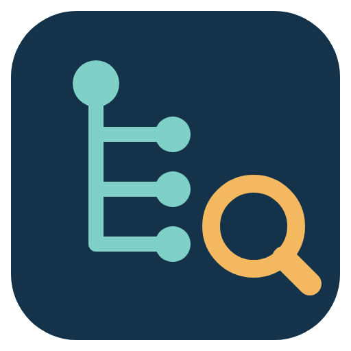

# UNS-as-Code Explorer

> **Beta 0.1.4 — not a final version.** Things will change, some views are rough, and there will be bugs. Feedback is welcome (Issues).

A read-only desktop explorer for a Unified Namespace — **NATS, MQTT or Kafka** — as simple as MQTT Explorer.

- **Without a model** it shows the topic tree, live values, telemetry vs transactional (with the reason), data quality and naming findings.
- **With a UNS-as-Code model git** it adds the semantics: the plant from the model's instances, profiles, units, ISA-95 objects, the rules
  on an attribute and where their band comes from, *follow a work order*, *follow a decision* and the gaps between model and broker.

The Explorer **only reads**: it never publishes to a broker, never commits Kafka offsets and never writes to the model git.
No telemetry, no phone-home.

## Download

The newest version, always:

- **Windows 10/11 (x64):** [https://github.com/TobiasLante/uns-as-code-explorer/releases/latest/download/UNS-as-Code-Explorer-win-x64.zip](https://github.com/TobiasLante/uns-as-code-explorer/releases/latest/download/UNS-as-Code-Explorer-win-x64.zip)
  unzip, run `UNS-as-Code Explorer.exe` (not signed yet: Windows SmartScreen asks once)
- **Linux (x64):** [https://github.com/TobiasLante/uns-as-code-explorer/releases/latest/download/UNS-as-Code-Explorer-linux-x86_64.AppImage](https://github.com/TobiasLante/uns-as-code-explorer/releases/latest/download/UNS-as-Code-Explorer-linux-x86_64.AppImage)
  `chmod +x` and run (needs FUSE 2)

Older versions and `SHA256SUMS`: [Releases](../../releases).

On the first start the Explorer opens the public UNS-as-Code model on GitHub (`osf-schemas`, branch `next`, plant `werk1`), so you can look
around without a broker. Connect a broker when you want live values.

## Connect

- **NATS:** `nats://host:4222` or `tls://host:4222`; user + password, a `.creds` file (JWT) and/or a CA file.
- **MQTT:** `mqtt://host:1883`, `mqtts://host:8883`.
- **Kafka:** `kafka://host:9092[,host2:9092]`, `kafka+ssl://…`.
- With a CA file TLS is required — never a silent fall back to plain text. Passwords and tokens are kept in the system keychain, never in plain text.

## Model (optional)

A UNS-as-Code model git: a local clone or its URL (the Explorer clones it into its own cache, read only). Pick a release tag
`unsac/<x.y.z>` or a branch, and the site.

## Known limitations (beta)

- Payloads: JSON only (Avro and Sparkplug B are planned).
- Windows build is a zip, not an installer, and not code-signed yet.
- Large brokers: the topic tree keeps a bounded history per subject; very large retained sets take a while to load.

## Licence

Apache-2.0 — see [LICENSE](LICENSE) and [NOTICE](NOTICE).
